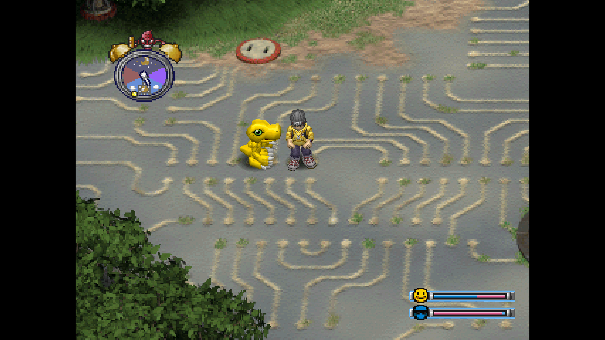
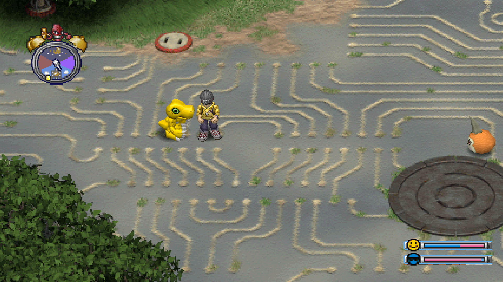
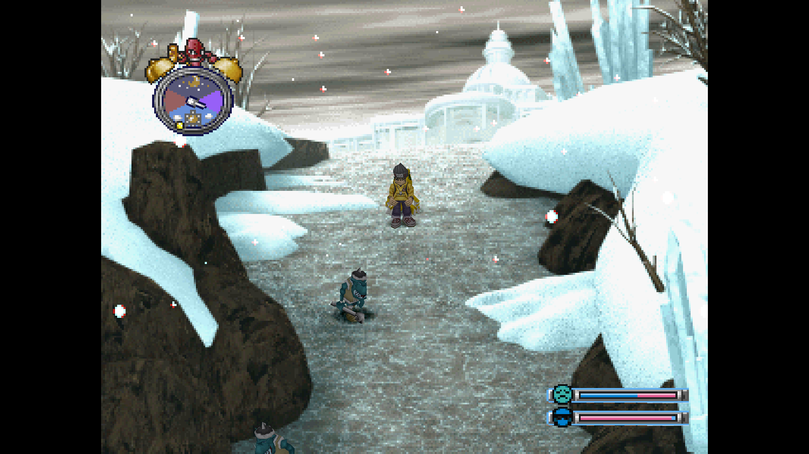
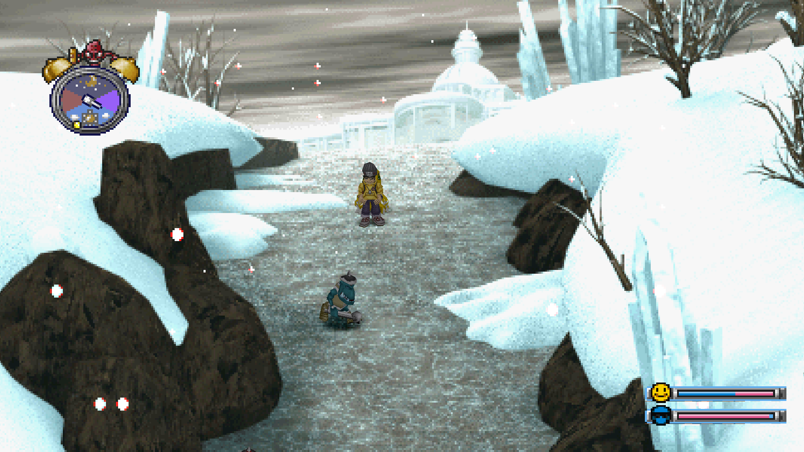
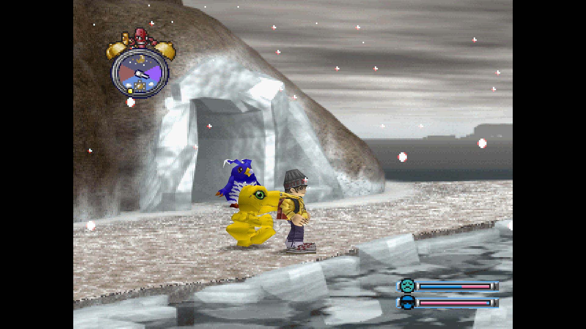
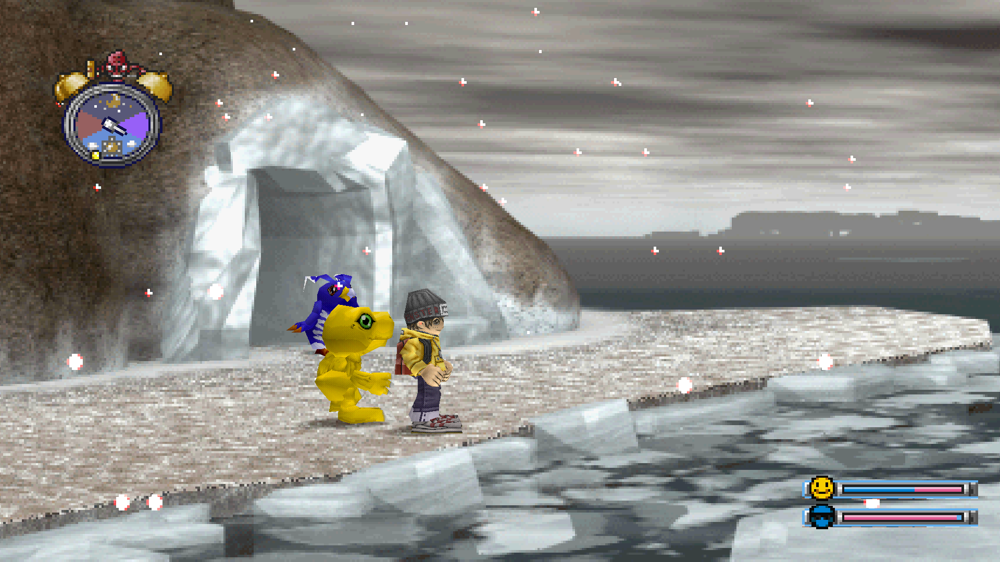
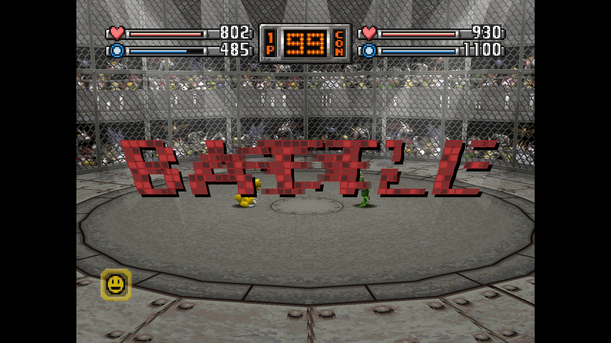
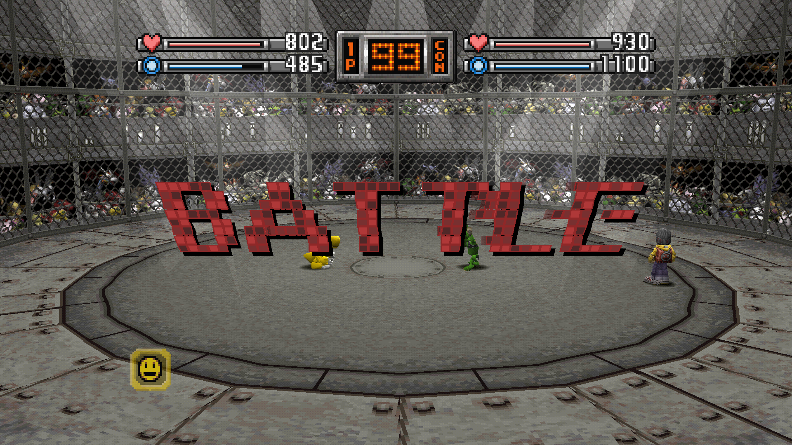
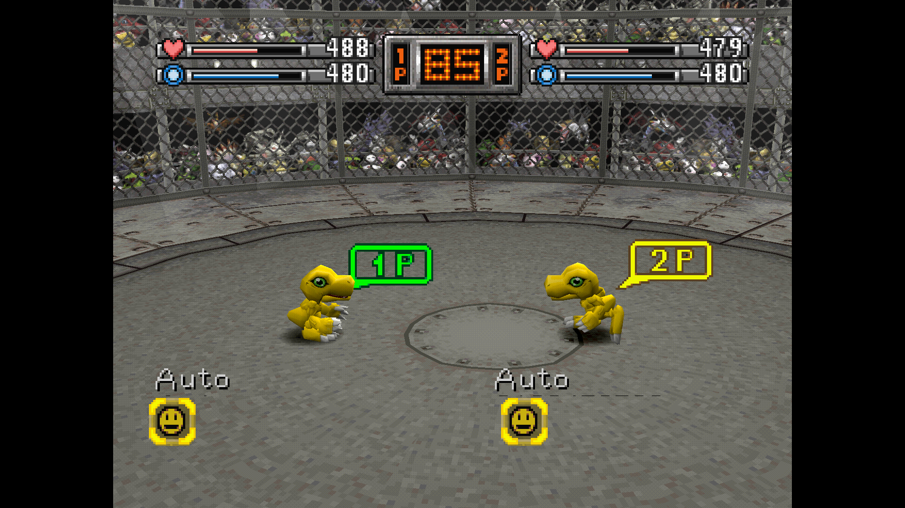
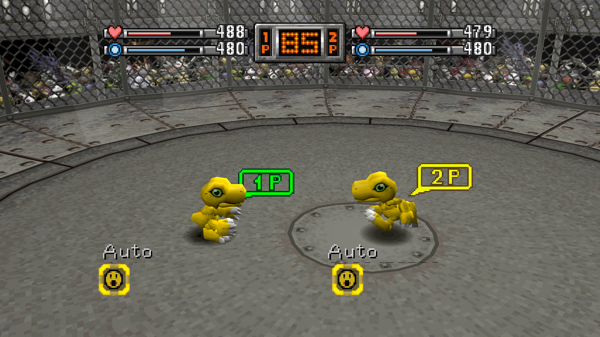

# Digimon World 1 PC Native

Digimon World (PlayStation, 1999) running natively on Windows. This is not an
emulator: it is the game's own code, decompiled to C, built as a Windows
program, with PC versions of the PlayStation libraries it calls.

You need your own copy of the game: a disc image of **Digimon World (USA,
SLUS-01032)**, the `.cue` and `.bin` files. Nothing from the disc is included
here; the game reads it from your disc image.

## Pictures

The PlayStation's 4:3 picture (left) and the optional widescreen (right, F1).

| 4:3 | Widescreen |
|---|---|
|  |  |
|  |  |
|  |  |
|  |  |
|  |  |

## Install

1. Download the installer from [Releases](../../releases).
2. Run it. Windows may say "Windows protected your PC": More info, Run anyway.
3. Point it at the `.cue` (or the `.bin`) of your Digimon World disc. The
   installer checks that it is the USA disc. The game reads the disc from
   where it is, so keep those files there.
4. Play from the desktop shortcut.

## Saving

New Game, START SLOT 1, pick a slot, Yes. A game started with NO MEMORY CARD
cannot be saved, as on the PlayStation. Saves go to `memcards\card1.mcd` in
the game folder, in the format DuckStation uses: a DuckStation memory card
copied there works, and back.

## Keys

| Key | Does |
|---|---|
| Arrows | D-pad |
| Enter | Cross |
| Esc | Start |
| V | Circle |
| X | Square |
| Z | Triangle |
| Space | Select |
| A / D | L1 / R1 |
| Right Shift / Left Shift | L2 / R2 |
| Alt+Enter | Fullscreen / window |
| F1 | Widescreen on / off |
| Ctrl+F3 | SOLID / CONSOLE 3D |

Game controllers work too (tested with a DualSense); the left stick works as
the D-pad.

## Widescreen

The game starts in the PlayStation's 4:3 picture. Press F1 to switch
widescreen on or off at any time. The picture then fills a wide screen at the
same scale, nothing stretched: you see more of the map, the arenas and the
battles at the sides. The clock, the status bars and the battle HUD go to the
corners; menus, text boxes and movies stay as on the PlayStation. The picture
stops at the edge of a map, and a room narrower than the screen is zoomed a
little to fill it. How the game plays does not change.

**Disclaimer:** widescreen is new, and the game was made for the
PlayStation's 4:3 picture, so some areas may not work very well in widescreen
(something missing, cut off or out of place at the sides). If an area looks
wrong, press F1 to go back to 4:3; the game works the same either way.

## Looking for more?

This project only brings the original game to PC, with a few small extras
such as widescreen. The game itself is left as it was.

If you want something much bigger, I highly recommend
**Digimon World: Definitive Edition**. It is the original game rebuilt in
Unity, with new Digimon (Megas included), new maps, new finishing moves,
remastered art, online battles and a lot more. It feels like the game got a
whole new DLC, and every new feature can be switched off if you want the
original.

It is made by **IAnime Estúdio**. I am not part of it, but they clearly know
what they are doing. It is still in development, with no download yet.

Trailer: https://youtu.be/MfRXYzcOUkQ

## Credits

- **jype0** and everyone who contributed to
  [dw_decomp](https://github.com/jype0/dw_decomp), the decompilation of
  Digimon World this port is built on. Without their work this would not
  exist.
- **Psy-Cross (Psy-X)** by the REDRIVER2 Project (MIT licence), through
  SlickAmogus's fork: the PlayStation graphics, sound and disc layer the port
  runs on.
- **SDL2** and **OpenAL Soft**.
- PC port by **kingzmanh**.

Digimon World is © Bandai. This is a fan project, not affiliated with or
endorsed by Bandai Namco. No game files are included or distributed; you need
your own copy of the game.
